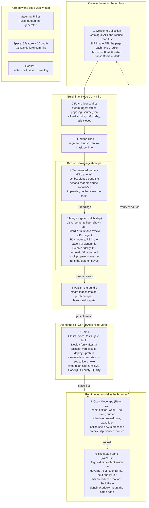

# Architecture

![Her Hand in the Steam, architecture as built, drawn as a sash window and read 1 to 9. Upper sash, outside the repo: 1 the Wellcome Collection archive (Catalogue API for the licence, IIIF Image API for the page and each note's region; MS.1810 p.23, c. 1750, Public Domain Mark). Left lower pane, build time, down: 2 steam-ingest fetch checks the licence first against the allow-list pdm, cc0, cc-by; 3 segment cuts the line strips and an ink mask per line; inside the Kiro workflow ingest-recipe, 4 two isolated Kiro agents, scribe on claude-opus-5.5 and second-reader on claude-sonnet-5.5, read the strips in parallel, and 5 the code gate merges their readings, keeps disagreements as daggers, takes a Kiro agent's word cuts and stroke review, and checks properties P1 to P6, re-run on saves by the props-on-save hook; 6 steam-ingest catalog publishes the bundle to public/recipes/ behind the catalog-gate hook. Along the sill: 7 a push to main runs GitHub Actions; CI (lint, types, tests, gate, build) must pass before Deploy runs vercel build and deploy --prebuilt to steam.edycu.dev, followed by a live smoke test; every push also runs E2E, CodeQL, Security and Quality. Right lower pane, runtime with no model in the browser, up: the static files load 8 the Cook Mode app (shelf, edition, Cook, The hand, quoted; scheduler, reveal gate, wake lock; offline shell), which reveals the scan's own ink in 9 the WebGL2 steam pane, shown with the renderer's own held frame of "till it Looks red & smooth"; a dashed verify-at-source link returns from the app to the archive. Below: Kiro steering (5 files), specs (5 feature, 10 bugfix) and hooks (6), how the code was written.](docs/architecture.png)

Read it as a window, steps 1 to 9: the archive is outside, in the clear upper sash. The left pane is **build time** (top to bottom), the sill is **shipping** (left to right), the right pane is **runtime** (bottom to top), and the dashed "verify at source" link closes the loop at the archive the ink came from. Below the window is how the code itself was written. At build time two isolated Kiro agents read the page, run through the `ingest-recipe` workflow; a Kiro agent then chose the word boundaries (`alignment.json`) and settled the joined strokes (`ownership-review.json`), and the code gate checks every result. The browser runs no model.

The same boxes and arrows as text:

## Where each box lives

| Box | Files in this repo |
|---|---|
| 1 Wellcome Collection | `tools/steam-ingest/fetch.ts` (`catalogueUrl`: `api.wellcomecollection.org/catalogue/v2/works/<id>?include=items`; then the IIIF manifest and image service); the record of what was fetched: `content/recipes/quinces-marmalade/source.json` |
| 2 Fetch, licence first | `tools/steam-ingest/fetch.ts` ("licence first, then manifest, then the page"; writes `page.jpg` and `source.json` only after everything succeeded), `src/ingest/licence.ts`, `LICENCE_ALLOW` (`pdm`, `cc0`, `cc-by`) in `src/ingest/constants.ts` |
| 3 Find the lines | `tools/steam-ingest/segment.ts` (writes `lines.json`, `region.json`, `runs.json`, `strips/`, `ownership/`), `src/ingest/segment.ts` (with `threshold.ts`, `deskew.ts`, `components.ts`, `lines.ts`, and `ownership` from `masks.ts`) |
| Kiro workflow `ingest-recipe` | `.kiro/workflows/ingest-recipe.workflow.json`: a `parallel` step `readers` (both agents), then a `watch` step `gate` that runs `npx tsx tools/steam-ingest/cli.ts gate --once`. How the runs went: [`docs/KIRO.md`](docs/KIRO.md) |
| 4 Two isolated readers | `.kiro/agents/scribe.json`, `.kiro/agents/second-reader.json`; their readings: `content/recipes/quinces-marmalade/agent/scribe.json`, `agent/second.json` |
| 5 Merge + gate | `tools/steam-ingest/watch.ts` (the watch-step protocol) → `tools/steam-ingest/gate.ts` → `src/ingest/gate.ts` (`mergeReadings`, `noteOwnership` from `masks.ts`, `buildNote` from `timeofink.ts`); properties P1-P6 in `src/ingest/props.ts` and `src/ingest/gate.ts`; result: `content/recipes/quinces-marmalade/gate.json` (P1-P6 pass). Its other agent-made inputs: `alignment.json` (word boundaries, by a Kiro agent) and `ownership-review.json` (joined strokes, by a Kiro agent). Hook: `.kiro/hooks/props-on-save.json` → `tools/hooks/props-on-save.ts` re-runs the gate when an agent writes a gate input |
| 6 Publish the bundle | `tools/steam-ingest/catalog.ts`, the only writer of `content/catalog.json`; it refuses a recipe whose gate did not pass, and an agent-transcribed recipe without a `review.json` that matches the gate; it copies `recipe.json`, `page.jpg` and the note files to `public/recipes/<id>/`. The review record is agent-signed, not a human's (README, "Honest limits"). Hook: `.kiro/hooks/catalog-gate.json` → `tools/hooks/catalog-gate.ts` refuses a write to the catalog that lists a recipe failing those checks |
| 7 Ship it | `.github/workflows/ci.yml` (lint: oxlint + actionlint; typecheck; unit + property tests on Node 22 and 24; `npm run props`, the gate; build + `check:dist`), `.github/workflows/deploy.yml` (runs only after CI succeeds on a push to main, or by hand from main: `vercel pull`, `vercel build --prod`, `vercel deploy --prebuilt --prod`, GitHub environment `production`), `scripts/live-smoke.ts` (after the deploy: `/`, `/landing/`, `/deck/`, the hero deep link in Chromium and the files it loads, and the served bundle name against the built one); the build itself: `vite.config.ts`, `tools/offline/vite-plugin.ts` (emits `dist/sw.js` with the precache list), `tools/site/vite-plugin.ts` (`dist/site/glass.js` for the landing page and deck), `vercel.json`; live at https://steam.edycu.dev. Beside it on every push: `.github/workflows/e2e.yml` (Playwright), `codeql.yml`, `security.yml` (gitleaks, npm audit, dependency review), `quality.yml` (Lighthouse CI with `lighthouserc.json`, `scripts/bundle-budget.ts`). The Vercel project has no Git integration, so `deploy.yml` is the only path from a push to production |
| 8 Cook Mode app | `src/App.tsx`, `src/app/router.ts` (hash router), `src/app/Shelf.tsx`, `Edition.tsx`, `Cook.tsx`, `Quoted.tsx`; `src/cook/scheduler.ts` (sleep and resume), `src/cook/clock.ts` (wall time), `src/app/useCookSession.ts` (sleep and resume from page visibility), `src/cook/revealGate.ts`, `src/cook/visibleTimer.ts` (the visible-only wait for the final wipe), `src/cook/wakelock.ts`; `src/offline/` (the service worker that serves the Cook path offline); the verify link: `src/app/components/ArchiveSlip.tsx` → `regionUrl` in `src/data/provenance.ts` |
| 9 The steam pane | `src/steam/renderer.ts` (`getContext('webgl2')`), `src/steam/governor.ts` (`GOV_P95_MS = 18`, `MAX_TIER = 3`), `src/steam/SteamGlass.tsx` (static when reduced motion, no WebGL2, or a lost context that is not restored within 2 s), `src/steam/StaticPane.tsx`, `src/steam/drips.ts`; `site/glass.tsx` + `site/GlassPane.tsx` mount the same `SteamGlass` on `/landing/` and `/deck/` |
| Steering, specs, hooks | `.kiro/steering/` (5 files), `.kiro/specs/` (5 feature specs, 10 bugfix specs), `.kiro/hooks/` (6) → `tools/hooks/*.ts` → `docs/kiro-evidence/hooks.log`. Five hooks run on write, shell and file-save events; the sixth, `tests-after-task`, runs at the end of a spec task and has no `hooks.log` line (it does not fire in headless runs). How each was used: [`docs/KIRO.md`](docs/KIRO.md) |

## Notes

- **The picture inside the steam pane** is the renderer's own frame, not an illustration: `public/recipes/quinces-marmalade/panes/till-it-looks-red-smooth-page-held.webp`, written by `scripts/render-static-panes.ts`, which opens the live pane and photographs it (the same images `StaticPane` shows). It is cropped and scaled down to fit the figure.
- **Not drawn as an arrow:** the `panes/*.webp` files reach `public/` through `scripts/render-static-panes.ts` (`npm run static-panes`), not through `steam-ingest catalog`; a catalog run clears `public/recipes/<id>/` first, so the panes are rendered again after it. The diagram shows one recipe-bundle arrow.
- **Commit labels:** each product commit says who wrote it, `[kiro]` or `[claude-direct]`; count them with `git log --format=%s | grep -c '^\[kiro\]'`.
- **Not drawn as boxes:** `scripts/verify_provenance.py` makes the same trip as the dashed arrow: it re-fetches each note's region from the IIIF Image API and checks the bundled crop against it (README, Engineering Rigor).
- The diagram is drawn at 880 px wide, the README column, and rendered at 2x (1760 px). Its source is kept outside this repository; it is drawn from the files listed above.
