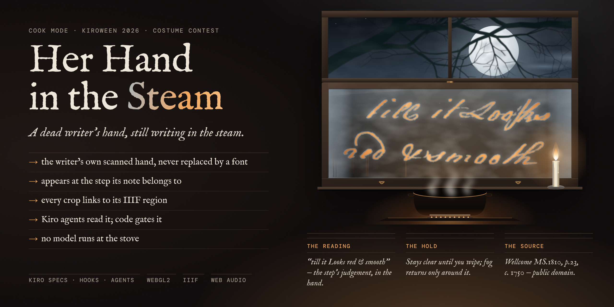

<div align="center">
  
  <h1>Her Hand in the Steam 🕯️</h1>
  <p><em>A dead writer's hand, still writing in the steam.</em></p>
  

  Cook Mode for handwritten recipes. At the step where the writer left a judgement in their own words, steam condenses on a pane of glass and that writer's scanned hand is wiped clear out of the fog.

  <br/>

  [](https://steam.edycu.dev/#/r/quinces-marmalade/cook?note=till-it-looks-red-smooth&pace=12&lead=6)
  [](https://kiroween.devpost.com/)

  <br/>

  
  
  
  
  
  [](LICENSE)
  [](https://github.com/edycutjong/steam/actions/workflows/ci.yml)

</div>

---

## 📸 See it in Action

*The banner above is an illustration composed from the scan; the live app renders the glass in WebGL2.*

**Try it:** [open the hero moment](https://steam.edycu.dev/#/r/quinces-marmalade/cook?note=till-it-looks-red-smooth&pace=12&lead=6). No install and no input: the pot runs at a visible ×12 pace and the note is written out of the fog after a 6 s lead-in. [`DEMO.md`](DEMO.md) has the exact judge steps and what to expect at each one.

The recipe is *Marmalade of Quinces* from Wellcome Collection MS.1810, an anonymous collection of cookery receipts, "by several hands", c. 1750. The three notes you can meet in Cook Mode are the writer's own words, cut from the scan: "till it Looks red & smooth", "when Tender", "full ripe".

## 💡 The Problem & Solution

### The Problem
Handwritten recipes hold what typed recipes lose: the judgement calls. Typing a recipe up flattens "till it looks red & smooth" into a line of text, and the person who wrote it disappears.

### The Solution
Cook Mode runs the recipe's steps against a pot on a fogged window. At the step where the writer left a judgement, the lamp dips, the simmer drops, and the writer's own ink is wiped clear of the glass. The typed step stays on screen for reading and for screen readers. **The handwriting is never generated:** the ink is the scan's own ink lifted off the paper: its shape and density come from the scan and are drawn in the renderer's colour, a processed render and not a copy of the scan's pixels. `scripts/verify_provenance.py` re-fetches each note's region from the archive and checks that the bundled page crop matches it and that the displayed ink lies inside it. The write-on follows a traced path through that ink, so the order of strokes is ours, not the writer's. "Verify at source" opens the untouched region on the archive's server.

## 🏗️ Architecture & Tech Stack

| Layer | What |
|---|---|
| App | React 19 + TypeScript, Vite, hash router (shelf, edition, Cook Mode, "The hand, quoted"); static `dist/` on Vercel, offline-capable shell (service-worker precache of the Cook path) |
| Renderer | One WebGL2 steamed-glass renderer: fog field, droplets and runs, candle, a quality governor that steps down to a static pane |
| Ingestion | `tools/steam-ingest`: IIIF fetch with a licence allow-list, code-built ink-ownership masks per line (the word boundaries inside a line are chosen by a Kiro agent from code-found runs and checked by the gate), and a gate of properties P1-P6 that a recipe must pass before it reaches Cook Mode |
| Agents | Two isolated Kiro custom agents read the page (`scribe`, `second-reader`); disagreements are kept and shown as `†`, never resolved by a model |
| Runtime model | None. The browser runs no model |

An architecture diagram is not in this repository yet.

## 🏆 Kiro Integration

Kiro is the engine, not decoration. [`docs/KIRO.md`](docs/KIRO.md) is the causal chain: for each Kiro feature, the files that drove the work, the commits it produced and where to check it, plus what was planned and **not** built.

- **Specs:** 5 feature specs and 10 bugfix specs in [`.kiro/specs/`](.kiro/specs/). 8 of the 10 bugfix specs committed a failing test before the fix.
- **Steering:** 5 files in [`.kiro/steering/`](.kiro/steering/) encode "quoted, not generated".
- **Hooks:** 6 in [`.kiro/hooks/`](.kiro/hooks/); `docs/KIRO.md` section 2 states what they saw and what they missed, including the gap we measured in our own hook evidence.
- **Custom agents and a workflow:** [`.kiro/agents/`](.kiro/agents/) and [`.kiro/workflows/ingest-recipe.workflow.json`](.kiro/workflows/ingest-recipe.workflow.json).
- **Commit labels:** every product commit says who wrote it, `[kiro]` or `[claude-direct]`. Run `git log --format=%s | grep -c '^\[kiro\]'` to count.
- **Not built:** an MCP server, a Power, an archivist agent, the fog A/B and the spec-vs-vibe comparison. No build-wide credit total was kept (one workflow run is measured). All stated in `docs/KIRO.md` section 4.

Experiments, counted by what ran, with "not run" stated for the rest: [`docs/EXPERIMENTS.md`](docs/EXPERIMENTS.md). Friction with Kiro, dated: [`docs/DX-REPORT.md`](docs/DX-REPORT.md).

## 📊 Engineering Rigor

| Check | Result | Source |
|---|---|---|
| Unit and property tests | **1544 passed, 5 expected-fail** (169 files) | `npm test` (output: `docs/kiro-evidence/unit-run.txt`) |
| End-to-end (Playwright, local) | **113 of 114 passed; 1 fails**: `e2e/cook-session.spec.ts:110` (a deep link to a note withheld for its licence; reproduced on re-run, open) | `npm run e2e` (output: `docs/kiro-evidence/e2e-run.txt`) |
| Ingestion gate P1-P6 on the shelf recipe | pass | `npm run props` |
| Provenance: the bundled page region each note comes from matches a fresh IIIF fetch (the displayed note is a processed render of those pixels) | 3 of 3 notes match a fresh IIIF fetch, NCC .960 / .976 / .991 (threshold .90 fixed before the first run); a shifted region and a wrong page both fail | `scripts/verify_provenance.py` |
| Agent-output evals | 8 ran, 8 pass; E3 not run | `docs/EXPERIMENTS.md`, row 7 |

### Frame rate
From [`bench/results.json`](bench/results.json): Chromium 159 on an Apple M1 Max through ANGLE Metal, 15 s per profile, `npm run bench`. **The machine was not idle** while it ran (other jobs; the load averages are in [`bench/README.md`](bench/README.md)). Reproduce with `BENCH_ANGLE=metal npm run bench`. The renderer, governor and layout have changed since this run (`bench/README.md` records the shader at commit 553c771), so re-run before quoting it. This table is the second of two back-to-back runs; in the first, `desktop-1280x720` averaged 59.34 fps with 2 frames under 55 fps (`bench/README.md`).

| Profile | Avg fps | Frames under 55 fps | p95 frame | Quality tier at end |
|---|---|---|---|---|
| Desktop 1280×720 | 60 | 0 | 16.7 ms | 0 (full) |
| Desktop 1920×1080 | 60 | 0 | 16.8 ms | 0 (full) |
| Pixel 5 emulation, 4× CPU throttle, 393×851 @2.75 | 60 | 0 | 16.7 ms | 0 (full) |
| Capture setup 1920×1080 | 60 | 0 | 16.7 ms | 0 (full) |
| Software GL (SwiftShader), 1280×720, recorded, not a budget row | 34.96 | 182 | 50.1 ms | 3 (static pane) |

Emulated Pixel 5 only; no physical Android run was made. On software GL the quality governor gives up the animation and shows the static pane, so that row is not the full-quality figure.

### Honest limits
- The renderer's look gate (7/10) was **not met** at look pass 2: a frame review scored it 6.5 on desktop and 6.5 on phone. The shipped look pass 3 has no score recorded in this repository, so the animated renderer ships as a bounded claim. Record: `docs/kiro-evidence/renderer-v1/NOTES.md`, `docs/EXPERIMENTS.md`.
- Only one recipe is on the shelf, and the reading was done by two Kiro agents. The sign-off in `content/recipes/quinces-marmalade/review.json` is the builder's agent, not a human; a human sign-off is still owed.
- The manuscript gives no cooking times, so none is invented: each note is placed at its step or at a cited modern check time, and each time is labelled.

## 🚀 Getting Started

### Prerequisites
Node 22 and npm.

### Installation
```bash
npm ci
npm run dev        # http://localhost:5173
npm run build      # typecheck + production bundle in dist/
```

## 🧪 Testing & CI

```bash
npm test           # vitest: unit + property suites
npm run props      # ingestion gate over every recipe
npm run e2e        # Playwright (installs Chromium: npx playwright install chromium)
npm run bench      # frame-rate profiles → bench/results.json
```
CI is defined in `.github/workflows/ci.yml` (typecheck, tests, the gate, build, the dist check, e2e). **It has not run yet:** every GitHub Actions run so far was refused before the job started (account billing), so the badge above is red and the figures in this README come from local runs.

## 📁 Project Structure

```
.kiro/          specs, steering, hooks, agents, workflow: the build direction
src/steam/      the WebGL2 renderer      src/app/     shelf, edition, Cook Mode
src/ingest/     ownership masks, gate    tools/       steam-ingest CLI, hooks, evidence
content/        the recipe, its readings, review record
bench/          frame-rate runs          docs/        KIRO, EXPERIMENTS, DX-REPORT
```

## 📽️ Demo Materials

- Live: https://steam.edycu.dev
- Judge steps: [`DEMO.md`](DEMO.md)
- Demo video: not published yet.

## 📄 License

Code: MIT ([LICENSE](LICENSE)). The manuscript images are public domain: Wellcome Collection MS.1810, Public Domain Mark.

## 🙏 Acknowledgments

Wellcome Collection, for the manuscript and its open IIIF service. The unnamed writer of this page of *Marmalade of Quinces*.
